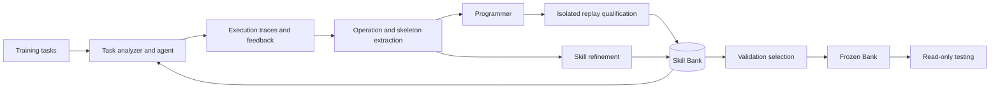

# SkillCompiler

**Reusable skills, executable programs, and ordered skill skeletons for tool-using agents.**

SkillCompiler turns execution experience into a persistent Bank of reusable operations. An agent solves training tasks with public tools, an extractor identifies reusable behavior, a programmer implements bounded operations, and a refinement stage updates skills using subsequent experience. Held-out validation selects a Bank; testing uses an immutable snapshot.

The core is task-agnostic. Dataset loading, environment actions, and scoring live behind a small adapter interface. Prompts are the base role instructions in [`prompts.py`](src/skillcompiler/prompts.py), with no benchmark-specific prompt overlays, answer heuristics, or task-name dispatch in the learning and execution pipeline.

## Architecture



- **Skills** describe applicability, prerequisites, procedure, and stopping conditions.
- **Programs** implement operations with explicit schemas and public-tool permissions. Python runs in a network-isolated container; declarative programs use bounded control flow.
- **Skill skeletons** connect operations through ordered dependencies and explicit input/output bindings. Nodes can execute a Program or ask the agent to carry out a textual operation.
- **Refinement** proposes evidence-backed revisions, implementation replacements, or merges. Both successful and failed training episodes remain available.

## Installation

Python 3.10 or newer is required. Program execution additionally requires Linux or WSL2 with Docker.

```bash
git clone https://github.com/YU-S3/SkillCompiler.git
cd SkillCompiler
python -m venv .venv
source .venv/bin/activate
pip install -e '.[dev]'
```

Run the deterministic, zero-HTTP integration example:

```bash
python -m examples.offline_demo --output runs/offline-demo
```

This example exercises native tools, extraction, validation selection, freezing, testing, and checkpoint reuse with a scripted model. Its scores are fixture behavior, not model evaluation results.

## Train, validate, and test

Copy [`configs/default.yaml`](configs/default.yaml) and set the adapter, model endpoint, model name, and budget. Provide the key through the named environment variable:

```bash
export MODEL_API_KEY='your-key'
skillcompiler run --config configs/default.yaml --output runs/experiment
```

The default endpoint is a placeholder. The model transport expects an OpenAI-compatible, non-streaming chat-completions response with JSON content. Explicit provider generation parameters belong in `model.parameters`; there are no model-name branches. Provider-specific thinking or output-limit behavior must be configured and checked for that provider before a paid run.

The pipeline:

1. Checks split disjointness and records the public input identities. Only the training order is shuffled.
2. Solves each training batch with the current Bank and records actual tool execution and evaluator feedback.
3. Extracts proposed updates. New Programs must reproduce declared outputs from observed training events in an isolated replay environment. One structural repair is allowed by default.
4. Applies the configured number of Train-only refinement rounds.
5. Evaluates unique Bank checkpoints on validation tasks. A candidate must exceed the current score by more than `min_gain`; ties retain the earlier Bank. Validation feedback never enters extraction or refinement.
6. Freezes the selected Bank and evaluates the Test split. The Bank digest must remain unchanged.

To resume, use the same command, output directory, source, configuration, and inputs. Completed task and learning checkpoints are verified and reused. A changed run identity is rejected. One process may own an output directory at a time.

### Enable Programs

Choose a locally installed Python image and pin its immutable digest:

```bash
docker pull python:3.12-slim
docker image inspect python:3.12-slim --format '{{index .RepoDigests 0}}'
```

Put the returned digest in the configuration:

```yaml
worker:
  image: python@sha256:YOUR_LOCAL_IMAGE_DIGEST
  timeout: 60
  memory_mb: 1024
```

Programs cannot execute directly on the host. The worker disables networking, mounts its source read-only, drops capabilities, runs as a non-root user, and enforces time, memory, process, and RPC limits. Install any required libraries in your own image before pinning its digest. Native tool effects remain the adapter's responsibility.

## Bring an environment

Implement a `TaskSuite` and point `adapter.factory` to `your_module:factory`. The factory returns an object with:

```python
tasks(split)                 # list[Task]; public inputs only
open(task)                   # fresh, isolated Environment
score(task, answer, env)     # Feedback; native evaluator
```

An Environment exposes `observe()`, `tools()`, `call(name, arguments)`, and `close()`. Each tool declares an input schema and may declare an output schema. The learner reopens environments to replay qualification cases, so reset behavior must be deterministic or explicitly controlled by the adapter.

Keep private answers and evaluator state out of `Task.inputs`, observations, and tool results. Use the native evaluator in `score()`. See the complete synthetic adapter in [`examples/key_value.py`](examples/key_value.py) and the [interface guide](docs/interfaces.md). Real dataset loaders, data downloads, and benchmark evaluators are supplied separately.

## Portable Banks

The [`benchmark/`](benchmark/) directory contains deployment content organized by benchmark:

| Directory | Skills | Programs | Skeletons |
|---|---:|---:|---:|
| `alfworld` | 9 | 9 | 6 |
| `searchqa` | 7 | 4 | 1 |
| `officeqa` | 37 | 5 | 0 |
| `docvqa` | 11 | 1 | 0 |
| `livemath` | 4 | 3 | 2 |
| `spreadsheetbench` | 7 | 0 | 0 |

Each directory contains `bank.json` and any required Program source files. It contains skill guidance, executable contracts, and references, without experiment logs, model identifiers, seeds, or training histories. Text-only Banks remain text-only; missing executable assets are not fabricated. Domain knowledge in these Banks is data, not an overlay in the core prompts.

```bash
skillcompiler check-bank benchmark/alfworld
skillcompiler evaluate --config configs/my-environment.yaml \
  --bank benchmark/alfworld --split test --output runs/evaluation
```

These are portable deployment assets, separate from the empty-Bank training example. Using them requires an adapter that implements their declared tools and inputs. The declarative Bank additionally requires the semantic-query and effect-verification interfaces described in the [Bank guide](docs/bank-format.md). This repository does not assert that the refactored runner reproduces historical experiment scores without a new evaluation.

## Records and resource accounting

Each run stores public task traces, training feedback, learning receipts, Bank checkpoints, selection scores, and final freeze hashes. Model requests preserve the actual payload, response, and raw usage; API keys are never written to receipts.

Every HTTP attempt requires budget admission. Exact returned usage is counted when available; interrupted or unmetered attempts retain their reservation. Retries are finite and consume the same run budget. Unknown usage is not silently treated as zero. The implementation is intentionally single-controller; use separate output directories and ledgers for independent runs.

## Verification

```bash
pytest -q
export SKILLCOMPILER_TEST_IMAGE='python@sha256:YOUR_LOCAL_IMAGE_DIGEST'
pytest -q tests/test_worker.py
```

Tests cover split isolation, Train-only learning, strict validation selection, immutable testing, checkpoint identity, native-tool limits, bounded IR execution, request retries and accounting, portable Bank round trips, actual Docker execution, and source-backed Program qualification. Docker tests are skipped when no image digest is supplied. They are engineering checks, not performance claims.

## Repository layout

```text
src/skillcompiler/   Generic learning, execution, storage, and evaluation
configs/            Explicit runtime and resource settings
benchmark/          Portable deployment Banks
examples/           Synthetic environment and offline integration demo
tests/              Unit and container integration tests
docs/               Adapter and Bank contracts
```

## License

The framework is distributed under the [MIT License](LICENSE). Retained third-party notices for reference guidance are in [THIRD_PARTY_NOTICES.md](THIRD_PARTY_NOTICES.md).
